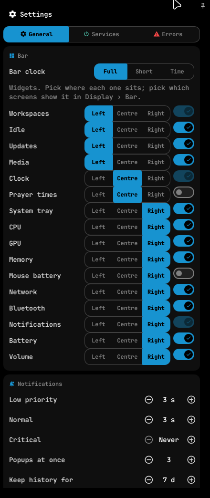

# Synchronisation Quickshell — Kilam / bboysidou

Date : 12 novembre 2026.

Ce document décrit les nouveautés de bboysidou intégrées au Quickshell de Kilam et les personnalisations à conserver lors d'une synchronisation. Il est accompagné d'un patch des sources, applicable à la version locale de référence de bboysidou.

## 1. Versions et périmètre

| Élément | Référence |
| --- | --- |
| Dépôt de référence | `https://github.com/bboysidou/dotfile_hyperland.git` |
| Copie de référence analysée | `/home/kilam/dotfile_hyperland/quickshell` |
| Commit de référence bboysidou | `4ba23087714d8561f9592e0e45b1613f4960de49` |
| Nouveautés importées | `df57d0aa805a0ea731bfe7178ceb37cc4adce22b` : `wheel-adjustable sliders and per-widget bar zones` |
| Dépôt personnel | `/home/kilam/.my-hyprland` |
| Commit personnel avant intervention | `14d340b` : `add windowrule & keymaps` |
| Configuration réellement utilisée | `~/.config/quickshell` → `/home/kilam/.my-hyprland/quickshell` |
| Environnement vérifié | Quickshell 0.3.2, Qt 6.12.0 |

La référence bboysidou est celle disponible localement au moment de l'analyse. Aucune vérification de la branche distante sur GitHub n'a été effectuée. L'intégration décrite ici est une modification locale non commitée.

Le dossier `/home/kilam/quickshell-prayer` est une sauvegarde et n'est pas la configuration active. Il n'a pas été modifié. Le dépôt `dotfile_hyperland` n'a pas été modifié non plus.

Tous les chemins de fichiers ci-dessous sont relatifs au dossier `quickshell/`, sauf mention contraire.

## 2. Nouveautés intégrées depuis bboysidou

### 2.1 Curseurs réglables avec la molette

Le composant partagé `core/components/Slider.qml` possède maintenant une propriété `wheelStep`. La molette émet le signal `moved()` utilisé aussi par le déplacement du curseur : chaque consommateur continue donc d'appliquer son propre traitement de la valeur.

- Une rotation verticale positive augmente la valeur ; une rotation négative la diminue.
- Sans mouvement vertical, le mouvement horizontal est utilisé avec le signe inversé.
- La valeur reste bornée entre `0` et `1`.
- Le pas par défaut est `0.05`, soit 5 % de la plage du curseur.
- Les curseurs audio utilisent `Appearance.audio.step / Appearance.audio.max` : avec la configuration actuelle, le volume change d'un point par événement de molette.
- Le curseur de fréquence utilise `1 / root.steps` : un événement passe au mode disponible voisin.
- Le curseur de fréquence reste désactivé lorsqu'un seul mode est disponible.

Ce comportement s'applique aux instances du curseur partagé : audio, luminosité, progression des lecteurs du dashboard et fréquence d'écran. Sur la progression musicale, le pas générique correspond à 5 % de la durée du morceau.

Le code utilise le signe du delta : plusieurs crans regroupés dans un seul événement ne multiplient pas le pas. Les événements de pavé tactile sans `angleDelta` ne sont pas traités par cet ajout.

Le lecteur cassette utilise son propre `DeckSlider.qml`, conservé sans modification.

### 2.2 Choix de la zone de chaque widget

Dans les réglages généraux, section Bar, chaque widget proposé dispose d'un choix `Left / Centre / Right`.

- Le nouveau singleton `core/enums/BarZone.qml` définit les trois zones.
- `Prefs.barZones` conserve uniquement les placements différents de la zone par défaut.
- Une préférence absente ou une zone enregistrée inconnue utilise la zone par défaut du widget.
- Le choix de zone est global : un même widget utilise cette zone sur les écrans où il est affiché.
- L'affichage et le masquage par écran restent gérés séparément par `barScreens`.
- Le choix d'une zone ne rend pas visible un widget désactivé ou masqué sur l'écran.
- Les widgets verrouillés restent non désactivables, mais leur zone peut être choisie.
- Le lecteur multimédia reste le dernier widget de sa zone pour permettre le calcul de sa largeur disponible.
- Les zones par défaut et l'ordre relatif des autres widgets restent ceux de la configuration existante.

Il s'agit d'un choix entre trois zones, pas d'un déplacement libre ni d'un réordonnancement arbitraire à l'intérieur d'une zone. Les trois listes sont aussi utilisées lorsque la barre est verticale.

La section des widgets passe à une colonne pour afficher les sélecteurs. Les libellés anglais proviennent de l'ajout de bboysidou.

### 2.3 Fichiers concernés par cette intervention

Treize fichiers existants ont été modifiés et un fichier a été ajouté :

| Fichier | Modification |
| --- | --- |
| `core/components/Slider.qml` | Traitement de la molette et propriété `wheelStep` |
| `core/config/appearance/SliderConfig.qml` | Pas générique `0.05` |
| `core/config/appearance/BarConfig.qml` | Ajout de `entryOrder`, sans modifier les dimensions personnelles des bureaux |
| `core/config/appearance/SettingsConfig.qml` | Présentation des sélecteurs de zone |
| `core/enums/BarZone.qml` | Nouveau singleton de définition des zones |
| `modules/bar/BarContent.qml` | Sélection des widgets par zone et budgets de largeur du média |
| `modules/bar/components/VolumePill.qml` | Pas audio de la molette |
| `modules/controlcenter/components/AudioCard.qml` | Pas audio de la molette |
| `modules/controlcenter/components/AudioHero.qml` | Pas audio de la molette |
| `modules/controlcenter/components/PowerOverview.qml` | Pas audio de la molette |
| `modules/controlcenter/components/SliderRow.qml` | Transmission du pas au curseur |
| `modules/display/components/RateSlider.qml` | Un mode de fréquence par pas |
| `modules/settings/components/BarSection.qml` | Sélecteur de zone pour chaque widget |
| `services/Prefs.qml` | Chargement, sauvegarde et filtrage des zones, fusionnés avec les préférences personnelles |

## 3. Personnalisations à préserver

### 3.1 Bureaux numérotés et associés à leur écran

Fichiers :

- `modules/bar/components/Workspaces.qml`
- `modules/bar/BarSlot.qml`
- `core/config/appearance/BarConfig.qml`

Dans la version de Kilam :

- `BarSlot` transmet `screenName` au composant `Workspaces`.
- Les bureaux existants sont filtrés selon leur moniteur effectif.
- Les bureaux vides définis dans la configuration peuvent apparaître avant d'être créés par Hyprland.
- Pour un bureau existant, son moniteur effectif prend priorité sur son affectation configurée.
- Le bureau actif est celui du moniteur de cette instance de barre.
- Les numéros des bureaux sont affichés dans les pastilles.
- `workspacePillSize` reste à `22`.

La référence bboysidou utilise une liste globale de bureaux, un minimum de neuf bureaux et des pastilles de taille `15`, sans ces numéros. Ces différences n'ont pas été importées.

Lors d'une fusion, conserver le passage de `screenName`, le filtrage par écran, le texte des numéros et les dimensions personnelles. L'ajout de `entryOrder` dans `BarConfig.qml` est indépendant de ces choix.

### 3.2 Service de prières réellement désactivable

Architecture personnelle :

```text
shell.qml
  └── PrayerModule
        └── LazyLoader actif si Prefs.loaded && Prefs.prayersEnabled
              └── PrayerCenter
                    ├── PrayerEngine
                    └── PrayerAlerts

services/Prayer.qml       : façade vers le moteur chargé
services/PrayerAlerts.qml : façade de compatibilité
```

Fichiers ajoutés ou adaptés :

- `modules/prayers/PrayerModule.qml`
- `modules/prayers/PrayerEngine.qml`
- `modules/prayers/PrayerAlerts.qml`
- `modules/prayers/PrayerCenter.qml`
- `services/Prayer.qml`
- `services/PrayerAlerts.qml`
- `modules/settings/components/PrayerSection.qml`
- `modules/settings/components/ServicesTab.qml`
- `modules/dashboard/DashState.qml`
- `modules/dashboard/DashboardPanel.qml`
- `services/Prefs.qml`
- `shell.qml`

`prayersEnabled` est sauvegardé avec les préférences. Quand il est faux, le moteur et les alertes de prière ne sont pas chargés. Le widget de prière est filtré dans `Prefs.barEnabled()`, et l'onglet de prière disparaît des sections du dashboard.

Le moteur calcule ses horaires selon le jour civil via `dayKey` ; les calculs solaires ne dépendent pas directement de chaque changement de minute.

L'interface de contrôle du chargement est conservée :

```sh
qs ipc call prayerControl status
qs ipc call prayerControl setEnabled true
qs ipc call prayerControl setEnabled false
```

Les deux dernières commandes changent volontairement la préférence ; elles sont fournies pour la vérification manuelle, elles n'ont pas été exécutées sur la session personnelle pendant cette intervention.

**Point de fusion essentiel :** conserver `prayersEnabled` dans sa déclaration, dans `adopt()`, dans `flush()` et dans `barEnabled()`. Ajouter `barZones` à côté, sans remplacer ces éléments. C'est la fusion réalisée ici.

### 3.3 Localisation partagée, indépendante des prières

Fichiers :

- `services/Location.qml`
- `core/constants/LocationDefaults.qml`
- `services/Weather.qml`
- `services/Prayer.qml`
- `modules/prayers/PrayerEngine.qml`
- `modules/settings/components/LocationSection.qml`

La météo lit `Location.place`, et non `Prayer.place`. La localisation reste ainsi utilisable lorsque le service de prières est désactivé.

`Location` choisit la ville selon l'ordre : ville épinglée, détection, cache, valeur de secours. L'état partagé utilise `location.json`. Si ce fichier manque, le service peut lire la localisation de l'ancien état des prières.

`LocationSection.qml` existe dans les sources, mais aucune instance n'a été trouvée dans les composants actuels : ne pas considérer sa seule présence comme une section déjà accessible dans les réglages. Cette intervention n'a pas modifié son branchement.

### 3.4 Rétroéclairage du clavier

Fichiers :

- `services/KeyboardBacklight.qml`
- `core/config/appearance/IdleConfig.qml`
- `modules/display/components/IdleTab.qml`
- `modules/lock/components/IdleGuard.qml`

Le service détecte et pilote le périphérique `tpacpi::kbd_backlight` avec `brightnessctl`. Le contrôle n'est affiché que si le périphérique est disponible. Lors de l'extinction des écrans par inactivité, le niveau précédent est retenu, l'éclairage est éteint puis restauré au retour.

La version actuelle cible ce nom de périphérique ThinkPad : une généralisation à d'autres claviers serait une évolution distincte. Aucun changement de niveau matériel n'a été effectué pour cette intégration.

### 3.5 Lecteur Cassette Deck

Conserver le dossier `cassette/`, son import dans `shell.qml` et l'instance `DeckWindow { visible: false }`.

Fonctions personnelles présentes :

- Lecture locale via QtMultimedia.
- Lecture YouTube via mpv et yt-dlp.
- Navigation dans les playlists, traitement des Mix et enchaînement des pistes.
- Historique, favoris de vidéos et favoris de playlists.
- Sauvegarde du volume, de la source, de la piste, de la position et de la taille de fenêtre ; restauration en pause.
- Façade cassette, bobines et vumètres Cava.
- Commandes IPC sous la cible `cassette`.

Le lecteur utilise ses propres contrôles. Il ne publie pas de service MPRIS ; il ne faut pas présumer qu'il est piloté par le widget média du dashboard.

Son état personnel est stocké hors des sources, dans `quickshell-cassette.ini`. Cet état, l'historique et les favoris ne font pas partie du patch fourni.

La documentation du lecteur reste dans `cassette/README.md`. Les tests du lecteur n'ont pas été relancés : aucun de ses fichiers n'a été modifié.

### 3.6 Ajustements complémentaires

| Fichier | Comportement personnel à garder |
| --- | --- |
| `services/MouseBattery.qml` | Vérification de la présence de `solaar` avant d'activer le sondage |
| `scripts/updates/sys_update.sh` | Appel `qs ipc call updates refresh` en fin de script pour rafraîchir l'indicateur |
| `shell.qml` | `QT_IM_MODULE=compose`, en plus des imports et instances personnels |
| `probe.qml` | Sonde adaptée aux services personnels, notamment au clavier |

Les fichiers de ces personnalisations sont restés identiques à leur état avant intervention, à l'exception des ajouts ciblés dans `Prefs.qml` et `BarConfig.qml` décrits plus haut.

## 4. Éléments déjà synchronisés

Les dossiers suivants sont identiques entre les deux configurations de référence :

- `modules/notifications/`
- `modules/fingerprint/`
- `modules/screenshot/`
- `modules/launcher/`
- `modules/updates/`

Les notifications de progression et les fenêtres de notification persistantes étaient déjà intégrées chez Kilam. Elles n'ont pas été réimportées.

Après cette intervention, les sources des curseurs et des zones de widgets correspondent à l'ajout de bboysidou, avec les deux adaptations de coexistence dans `Prefs.qml` et `BarConfig.qml`.

## 5. Fichiers communs restant différents

Cette liste est exhaustive pour les fichiers présents des deux côtés après l'intégration :

```text
core/config/appearance/BarConfig.qml
core/config/appearance/IdleConfig.qml
modules/bar/BarSlot.qml
modules/bar/components/Workspaces.qml
modules/dashboard/DashState.qml
modules/dashboard/DashboardPanel.qml
modules/display/components/IdleTab.qml
modules/lock/components/IdleGuard.qml
modules/prayers/PrayerCenter.qml
modules/settings/components/ServicesTab.qml
probe.qml
scripts/updates/sys_update.sh
services/MouseBattery.qml
services/Prayer.qml
services/PrayerAlerts.qml
services/Prefs.qml
services/Weather.qml
shell.qml
```

Ces différences sont intentionnelles. Elles ne constituent pas une liste de fichiers à écraser avec la version de référence.

Il existe aussi des fichiers propres à Kilam : le lecteur cassette, les services et composants décrits ci-dessus, `StatusChip.qml`, des documents, des copies de scripts sous `services/{gpu,decode,speedtest}/` et des fichiers sous `system/`.

Les commandes actives de GPU, décodage et test réseau pointent actuellement vers `scripts/`, comme dans la référence. Ne pas déduire de la présence des copies sous `services/` qu'elles sont les chemins exécutés. Les fichiers sous `system/` ne sont pas installés automatiquement par une copie des sources.

## 6. Patch fourni pour la synchronisation

Fichier : [synchronisation-bboysidou-2026-11-12.patch](synchronisation-bboysidou-2026-11-12.patch).

Le patch transforme le dossier `quickshell/` de la référence bboysidou `4ba23087` en sources personnelles actuelles de Kilam. Il inclut les fichiers supplémentaires et l'image de référence du lecteur cassette. Il exclut le dossier `quickshell/docs/`, les états utilisateur, les caches et les fichiers extérieurs à Quickshell.

Les deux nouveautés de `df57d0aa` sont déjà présentes dans la référence bboysidou : le patch de synchronisation exprime donc surtout les personnalisations personnelles qui restent à porter vers cette référence.

SHA-256 du patch :

```text
aa0fddb830ce93d34567314fbe769b206521a26e222122724f12ccc386c56fff
```

Taille : 332 190 octets. Son application a été vérifiée sur une copie temporaire de la référence, puis les empreintes des 600 fichiers de sources obtenus ont été comparées à celles de Kilam : correspondance complète, hors documentation.

### Application par bboysidou

Transmettre ce document **et le patch**. Le document décrit l'architecture ; le patch contient les changements de code nécessaires.

Sur un checkout propre du dépôt de référence, avec le patch conservé en dehors de ce checkout :

```sh
git status --short
git switch -c sync/quickshell-kilam-2026-11-12 4ba23087714d8561f9592e0e45b1613f4960de49
git apply --stat /chemin/synchronisation-bboysidou-2026-11-12.patch
git apply --check /chemin/synchronisation-bboysidou-2026-11-12.patch
git apply /chemin/synchronisation-bboysidou-2026-11-12.patch
git diff --check
git diff --stat
git status --short
```

Le patch ajoute des fichiers : ils apparaîtront comme non suivis jusqu'à leur ajout explicite à Git. `git diff --stat` seul ne les récapitule pas tous ; consulter aussi `git status --short`.

Si la branche de bboysidou a avancé après la référence, réaliser d'abord l'import sur cette branche dédiée, examiner les changements, puis les fusionner dans sa branche courante en résolvant les éventuels conflits. Le patch a été testé contre la référence indiquée, pas contre une branche future.

Le patch ne contient pas les réglages Hyprland extérieurs au dossier `quickshell/`. Pour le lecteur cassette, vérifier séparément la règle de fenêtre et l'éventuel raccourci décrits dans `cassette/README.md`. Il ne change pas non plus les services installés ou les règles udev du système.

### Préférences et état utilisateur

L'ajout de zones est rétrocompatible avec un état sans clé `barZones` : les zones par défaut sont utilisées. Une nouvelle sauvegarde ajoute la clé sans retirer `prayersEnabled`, `barScreens` ou les autres préférences connues.

Ne pas importer les fichiers d'état de Kilam pour récupérer ses fonctionnalités. Le code et les préférences d'une autre personne sont deux choses distinctes : chacun conserve son `settings.json`, sa localisation, ses historiques et ses favoris.

## 7. Vérifications réalisées

| Vérification | Résultat |
| --- | --- |
| `git diff --check` dans le dépôt personnel | Réussi |
| Analyse QML avec `/usr/lib/qt6/bin/qmlformat`, sans option de réécriture | Réussie sur les 14 fichiers de l'intégration |
| Chargement réel du shell après modification | Journal : `Reloading configuration...`, puis `Configuration Loaded` |
| Tests des curseurs réels via QtTest et événements de molette, avec Quickshell hors écran | `SYNC-CHECK PASS` |
| Restauration des préférences dans un second processus Quickshell | `SYNC-RESTORE PASS` |
| Comparaison SHA-256 avec l'état avant intervention | Seuls les 13 fichiers existants prévus ont changé |
| Ouverture du panneau de réglages dans la session | Sélecteurs de zone visibles ; capture contrôlée visuellement |
| Contrôle IPC du service de prières personnel après intégration | Service resté désactivé, non chargé, moteur non prêt |
| Application du patch de synchronisation dans une copie temporaire | Réussie ; 600 fichiers de sources identiques |

Les tests fonctionnels ont couvert :

- Augmentation et diminution par molette verticale.
- Mouvement horizontal, bornage à `0` et `1`, pas audio et curseur désactivé.
- Passage entre trois fréquences, borne supérieure et désactivation avec une seule fréquence.
- Zones par défaut, déplacement d'un widget, refus d'une zone invalide et retour à la zone par défaut.
- Placement du média en fin de zone.
- Maintien du filtre de prières désactivées et du masquage propre à chaque écran.
- Sauvegarde puis restauration des zones, de l'activation des prières et des préférences d'écran dans un second processus.

Ces tests ont utilisé des répertoires d'état, de configuration et de cache temporaires. Ils n'ont pas changé les préférences personnelles de la session. La vérification visuelle a ouvert puis refermé les réglages, sans changer de placement de widget.

Le shell actif n'a pas été redémarré par cette intervention ; son rechargement automatique a suffi au chargement observé. Les avertissements de périphérique audio factice et de portail existaient dans le journal avant ce rechargement.

Les tests des curseurs n'ont pas réglé le volume matériel, la luminosité réelle ou les modes physiques des écrans. Le fonctionnement matériel du clavier, l'authentification par empreinte et le streaming YouTube n'ont pas été retestés, leurs sources ayant été conservées.

### Capture des réglages



## 8. Vérifications manuelles recommandées après une fusion ultérieure

1. Vérifier les bureaux numérotés sur plusieurs écrans, y compris les bureaux vides et les changements de moniteur.
2. Déplacer CPU ou volume entre les trois zones, puis vérifier le choix après redémarrage du shell.
3. Vérifier que le masquage d'un widget sur un écran reste indépendant de son placement.
4. Tester la molette sur audio, luminosité, progression musicale et fréquence d'écran.
5. Désactiver les prières : aucun moteur ou alerte chargé, aucun onglet de prière, météo toujours disponible.
6. Réactiver les prières et vérifier la réapparition des éléments attendus et l'absence de doublons d'alertes.
7. Sur un clavier compatible, vérifier l'extinction et la restauration du rétroéclairage avec les écrans.
8. Ouvrir Cassette Deck, lire un fichier et vérifier les fonctionnalités YouTube et de restauration selon les dépendances installées.
9. Vérifier des barres horizontales et verticales et des écrans étroits : le choix des zones est commun, mais la place disponible varie.

Les anciens documents de `docs/` décrivent parfois des états antérieurs du shell. Pour cette synchronisation, utiliser le présent inventaire et les sources actuelles comme référence.
